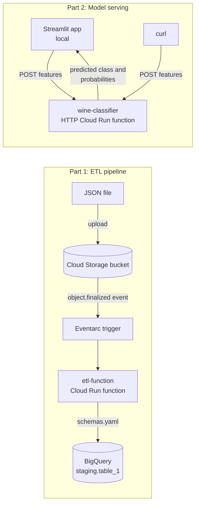

# LAB2_GCP

**Serverless ML on Google Cloud: ETL pipeline and Wine classifier with Cloud Run functions**

This project implements the **Cloud Functions lab** from the Northeastern University MLOps course ([raminmohammadi/MLOps](https://github.com/raminmohammadi/MLOps/tree/main/Labs/GCP_Labs/CloudFunction_Labs/Lab2-CloudFunction_Setup)) end to end on Google Cloud Platform, with a different dataset and model, and adds a Streamlit front end for the deployed model.

It has two serverless components and one client:

1. **ETL pipeline:** an event-driven Cloud Run function that loads JSON files from Cloud Storage into BigQuery as soon as they are uploaded.
2. **Wine classifier API:** an HTTP-triggered Cloud Run function that serves an RBF Support Vector Machine trained on the UCI Wine dataset.
3. **Streamlit app:** a local web interface that sends wine measurements to the deployed API and visualizes the predicted cultivar and class probabilities.

## Architecture



## Repository structure

```
.
├── Lab2-CloudFunction_Setup/
│   ├── main.py                  # ETL function: GCS -> BigQuery (entry point: hello_gcs)
│   ├── schemas.yaml             # BigQuery table schemas, matched by file name
│   ├── requirements.txt
│   ├── table_1.json             # Sample newline-delimited JSON test file
│   ├── ORIGINAL_LAB_README.md   # Instructions from the original course lab
│   └── ML-Example/
│       ├── main.py              # Wine classifier HTTP function (entry point: logfunction)
│       └── requirements.txt
├── wine_streamlit/
│   ├── app.py                   # Streamlit UI
│   ├── wine_client.py           # API client and local fallback model
│   ├── requirements.txt
│   └── .streamlit/config.toml
└── screenshots/
```

## Prerequisites

- A Google Cloud project with billing enabled
- Python 3.10 or later on your machine (for the Streamlit app)
- Region used throughout: `us-central1`

---

## Part 1: ETL pipeline (Cloud Storage to BigQuery)

### Step 1: Enable the APIs

In the Google Cloud Console, go to **APIs & Services > Library** and enable:

- Cloud Functions API
- Cloud Run Admin API
- Cloud Build API
- Eventarc API
- Artifact Registry API
- Cloud Pub/Sub API
- BigQuery API

### Step 2: Create a Cloud Storage bucket

1. Go to **Cloud Storage > Buckets** and click **Create**.
2. Enter a globally unique name, for example `PROJECT_ID-etl-bucket`.
3. Set the location type to **Region** and choose `us-central1`.
4. Keep the other defaults and click **Create**.

### Step 3: Set up IAM roles

Go to **IAM & Admin > IAM**.

**Default compute service account** (`PROJECT_NUMBER-compute@developer.gserviceaccount.com`). Click the pencil icon next to it and add these roles:

| Role | Why it is needed |
|---|---|
| BigQuery Admin | Create tables and run load jobs |
| Eventarc Event Receiver | Receive Cloud Storage events |
| Storage Object Viewer | Read the uploaded file during the BigQuery load |
| Cloud Run Invoker | Allow the trigger to invoke the function |
| Logs Writer | Write function logs |
| Cloud Build Builder | Build the function's container |
| Artifact Registry Writer | Store the built container image |

**Cloud Storage service agent** (`service-PROJECT_NUMBER@gs-project-accounts.iam.gserviceaccount.com`). Click **Grant access**, enter this account as the principal, and assign **Pub/Sub Publisher**. Cloud Storage uses it to publish upload events to Eventarc; without it, the trigger cannot be created. To see Google-managed accounts in the IAM list, tick **Include Google-provided role grants**.

The original lab lists only BigQuery Admin and Eventarc Event Receiver. The other roles were also required to deploy and run the pipeline on a current GCP project.

### Step 4: Create the BigQuery dataset

1. Go to **BigQuery**.
2. Next to your project, click the three-dot menu and choose **Create dataset**.
3. Set the dataset ID to `staging` (it is hard-coded in `main.py`) and the location to `us-central1`.
4. Click **Create dataset**.

### Step 5: Deploy the ETL function

**Console:** go to **Cloud Run > Write a function** and configure:

- Name: `etl-function`, region: `us-central1`, runtime: Python 3.11
- Trigger: **Cloud Storage**, event type `google.cloud.storage.object.v1.finalized`, your bucket
- Entry point: `hello_gcs`
- Source: `main.py`, `requirements.txt` and `schemas.yaml` from `Lab2-CloudFunction_Setup/`
- Memory: 512 MiB

**Or with gcloud**, from `Lab2-CloudFunction_Setup/`:

```bash
gcloud functions deploy etl-function \
  --gen2 --runtime=python311 --region=us-central1 \
  --source=. --entry-point=hello_gcs \
  --trigger-event-filters="type=google.cloud.storage.object.v1.finalized" \
  --trigger-event-filters="bucket=PROJECT_ID-etl-bucket" \
  --trigger-service-account=PROJECT_NUMBER-compute@developer.gserviceaccount.com \
  --memory=512Mi
```

### Step 6: Test the pipeline

`streaming()` matches the uploaded file name against the table names in `schemas.yaml`, so the file name must contain `table_1`. The file must be newline-delimited JSON (one object per line), not a JSON array.

```bash
gcloud storage cp Lab2-CloudFunction_Setup/table_1.json gs://PROJECT_ID-etl-bucket/
gcloud functions logs read etl-function --gen2 --region=us-central1 --limit=30
bq query --use_legacy_sql=false "SELECT * FROM staging.table_1"
```

**Result:** the upload triggers the function, which creates `staging.table_1` from the schema and loads both rows, including the nested, repeated `addresses` records:

```
Creating table: table_1
Created table PROJECT_ID.staging.table_1
```

| id | first_name | last_name | dob | addresses |
|---|---|---|---|---|
| 1 | John | Doe | 1990-05-14 | 1 address (Boston) |
| 2 | Priya | Shah | 1995-11-02 | 2 addresses (Boston, Cambridge) |

---

## Part 2: Wine classifier (HTTP function)

### How it works

On a cold start, `load_model()` finds no saved model in `/tmp`, so `train_and_save_model()` fits a `StandardScaler` and an RBF `SVC` on the Wine dataset and saves both with joblib. Later requests on the same instance reuse the saved model. `validate_features()` rejects any request that is not a list of 13 numeric values. The scaler matters here because the SVM is distance-based and the Wine features are on very different scales (proline is in the thousands, hue is around 1).

### Step 7: Deploy

**Console:** go to **Cloud Run > Write a function**, name it `wine-classifier`, choose an **HTTPS** trigger, allow unauthenticated invocations, select Python 3.11, set the entry point to `logfunction`, upload the files from `ML-Example/`, and set memory to 1 GiB and timeout to 120 seconds. The extra memory is needed because the model trains on the first request.

**Or with gcloud**, from `Lab2-CloudFunction_Setup/ML-Example/`:

```bash
gcloud functions deploy wine-classifier \
  --gen2 --runtime=python311 --region=us-central1 \
  --source=. --entry-point=logfunction \
  --trigger-http --allow-unauthenticated \
  --memory=1Gi --timeout=120s
```

### Step 8: Test

```bash
curl -X POST https://us-central1-PROJECT_ID.cloudfunctions.net/wine-classifier \
  -H "Content-Type: application/json" \
  -d '{"features": [14.23, 1.71, 2.43, 15.6, 127.0, 2.8, 3.06, 0.28, 2.29, 5.64, 1.04, 3.92, 1065.0]}'
```

**Result** (the first sample of the dataset, a cultivar 1 wine):

```json
{"predicted_class": 0, "prediction_confidences": [[0.9892, 0.0038, 0.0070]]}
```

Invalid input returns HTTP 400:

```bash
curl -X POST https://us-central1-PROJECT_ID.cloudfunctions.net/wine-classifier \
  -H "Content-Type: application/json" -d '{"features": [1, 2, 3]}'
# {"error": "Invalid input. 'features' must be a list of 13 numeric values."}
```

### Request and response format

| Field | Type | Description |
|---|---|---|
| `features` (request) | list of 13 numbers | In this order: alcohol, malic acid, ash, alcalinity of ash, magnesium, total phenols, flavanoids, nonflavanoid phenols, proanthocyanins, color intensity, hue, OD280/OD315 of diluted wines, proline |
| `predicted_class` (response) | int | 0, 1 or 2 (cultivar 1, 2 or 3) |
| `prediction_confidences` (response) | list | Class probabilities from `predict_proba` |

---

## Part 3: Streamlit front end

The app has inputs for all 13 features, presets that load a real sample of each cultivar, and a probability chart. A sidebar switch lets it call the deployed Cloud Function or run the same model locally, which is useful when the function is not deployed.

```powershell
cd wine_streamlit
python -m venv .venv
.\.venv\Scripts\Activate.ps1        # macOS/Linux: source .venv/bin/activate
pip install -r requirements.txt
$env:WINE_FUNCTION_URL="https://us-central1-PROJECT_ID.cloudfunctions.net/wine-classifier"
streamlit run app.py
```

The app opens at `http://localhost:8501`. The three presets are predicted as cultivars 1, 2 and 3 respectively.

---

## Screenshots

<!-- Add your screenshots to the screenshots/ folder and uncomment these lines.


-->

## Troubleshooting

| Error | Cause and fix |
|---|---|
| `storage.buckets.get denied` when deploying | The bucket does not exist or Eventarc cannot see it yet. Check the bucket name and wait a few minutes after setting IAM roles. |
| `The Cloud Storage service account ... unable to publish to Cloud Pub/Sub` | Grant **Pub/Sub Publisher** to the Cloud Storage service agent (Step 3), wait 2 to 3 minutes, and redeploy. |
| Function runs but no rows appear in BigQuery | Check the logs for `Error streaming file`. Common causes: the file name does not contain `table_1`, the file is a JSON array instead of newline-delimited JSON, or the trailing commas in `_load_table_from_uri` were not removed. |
| HTTP 403 when calling `wine-classifier` | The function was deployed without public access. Redeploy with unauthenticated access allowed, or send an identity token in the `Authorization: Bearer` header. |

## Cleanup

To avoid charges, delete the resources when you are done:

```bash
gcloud functions delete etl-function --gen2 --region=us-central1 --quiet
gcloud functions delete wine-classifier --gen2 --region=us-central1 --quiet
gcloud storage rm -r gs://PROJECT_ID-etl-bucket
bq rm -r -f -d PROJECT_ID:staging
```

## Acknowledgments

Based on the Cloud Functions lab from the [MLOps course](https://github.com/raminmohammadi/MLOps) by Prof. Ramin Mohammadi at Northeastern University. The Wine dataset is from the UCI Machine Learning Repository and is bundled with scikit-learn.
